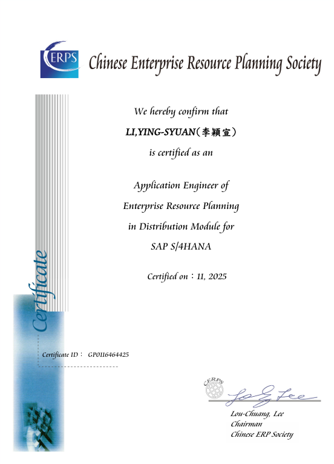
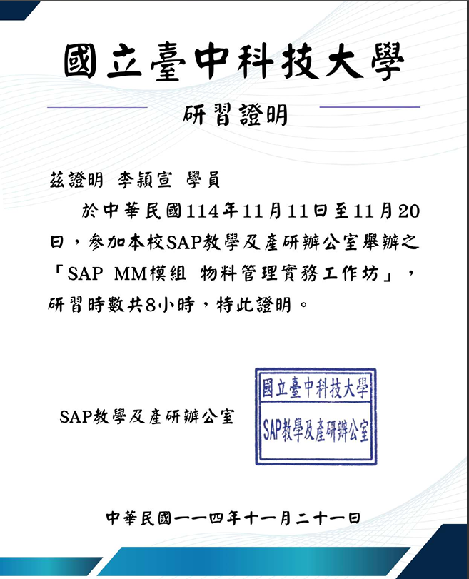
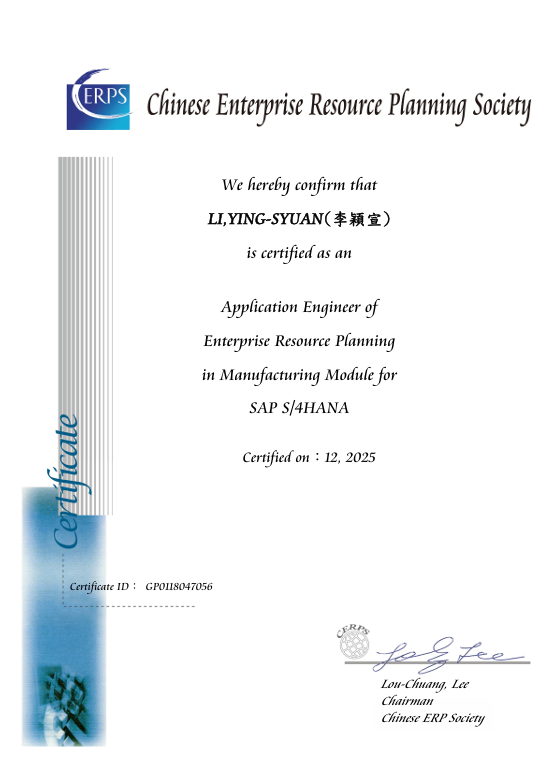
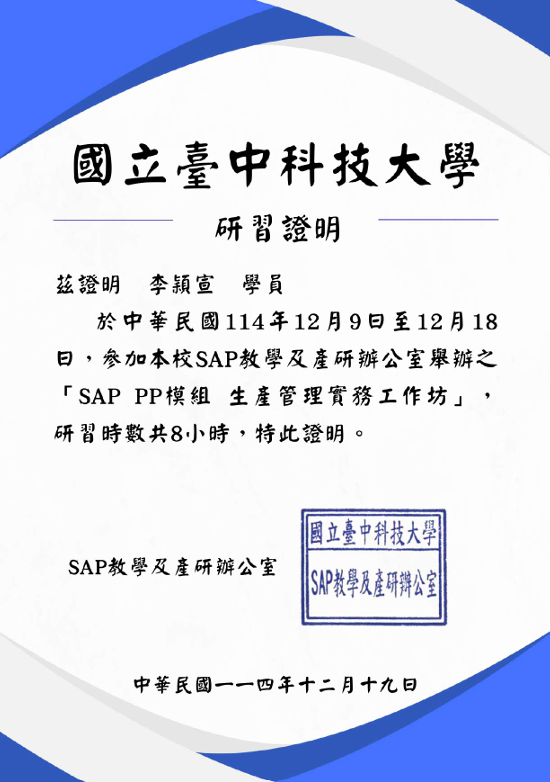
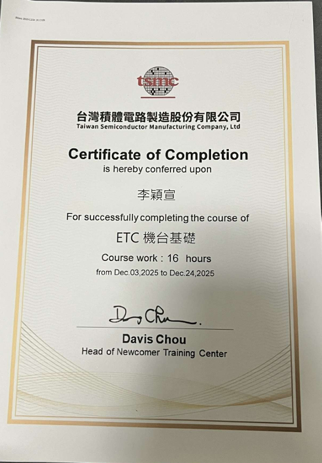
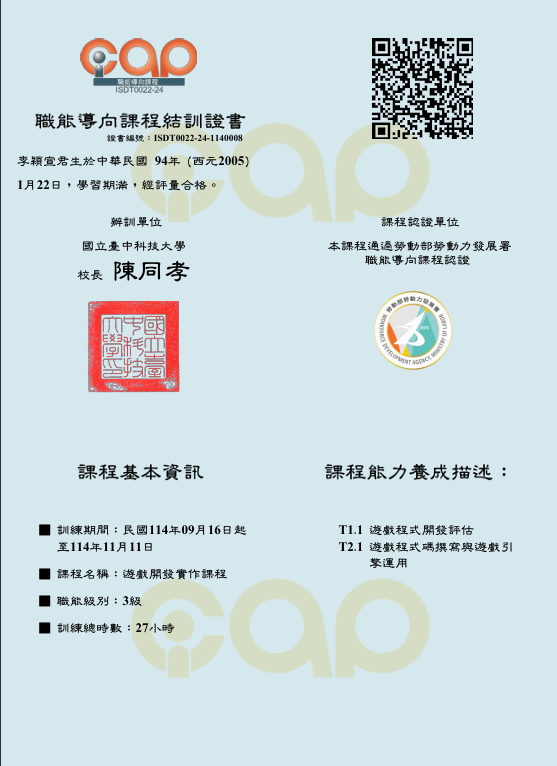

# 專業證照與培訓認證 (Certifications & Training)

本倉庫收錄大學期間取得之企業級 ERP 專業認證與研習證明、半導體機台專業培訓及軟體互動實作結訓證書。

---

## 1. 企業資源規劃 (ERP) 專業認證與研習

### 🔹 SAP ERP 核心模組 — MM 物料管理 (Materials Management)
* **認證名稱**：SAP Certified ERP Specialist - Materials Management (MM)
* **研習證明**：SAP ERP MM 物料管理核心模組實務班研習證明
* **取得時間**：2025 年 11 月
* **核心能力**：物料主檔規劃、採購詢價與訂單流程 (PO)、收料庫存異動管理與供應商評估機制。

  
  

---

### 🔹 SAP ERP 核心模組 — PP 生產管理 (Production Planning)
* **認證名稱**：SAP Certified ERP Specialist - Production Planning (PP)
* **研習證明**：SAP ERP PP 生產管理核心模組實務班研習證明
* **取得時間**：2025 年 12 月
* **核心能力**：生產工單開立 (MO)、物料清單 (BOM) 架構推導、工作中心排程與工序報工追蹤。

  
  

---

## 2. 半導體機台與智慧製造專業培訓

### 🔹 台積電 TSMC｜ETC 機台基礎培訓結業
* **發證單位**：台灣積體電路製造股份有限公司 (TSMC)
* **取得時間**：2025 年 12 月
* **核心內容**：晶圓製造廠運作架構、機台核心構造與運作原理、智慧製造設備基礎維護思維。

  

---

## 3. 軟體互動與遊戲開發實作認證

### 🔹 勞動部 iCAP 職能導向認證｜遊戲開發實作（3級）
* **發證單位**：勞動部勞動力發展署
* **取得時間**：2025 年 11 月
* **核心內容**：Unity 引擎操作、C# 物件導向邏輯、遊戲場景互動架構與狀態機實作。

  

